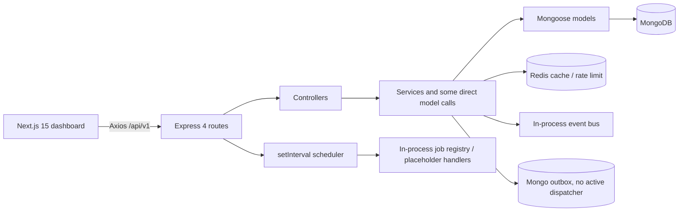
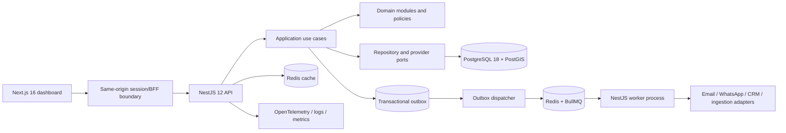

# Dubai Real Estate LeadGen — Architecture Review and Evolution Plan

**Review date:** 1 October 2026  
**Scope:** Source review of `frontend/` and `backend/`, existing tests/docs, demo configuration and launch scripts before implementation began. Findings below are a point-in-time baseline; execution and current verification are recorded in [EVOLUTION_EXECUTION_STATUS.md](./EVOLUTION_EXECUTION_STATUS.md).

## Executive summary

This is a capable product prototype with a broad CRM surface and several thoughtful domain concepts. The repository contains lead and property management, campaign and activity tracking, agent administration, analytics, scraper/webhook screens, and the beginnings of scoring, duplicate detection, assignment rules, status transitions, audit, event, outbox, tenant, and queue concepts.

The core problem is that the planned architecture is substantially ahead of the executable architecture. Most requests still use direct Mongoose calls, tenant context is not enforced by persistence, jobs execute in-process or return “queued” without queuing, events are swallowed in an in-memory bus, and integrations are placeholders. The result is not yet a dependable multi-tenant CRM backend: data isolation, mutation consistency, authentication/session behavior, background execution, and product-facing status need to be addressed before adding more “smart” behavior.

**Recommendation:** rebuild the backend incrementally as a **NestJS 12 modular monolith** with explicit domain modules and application use cases; use **PostgreSQL 18** as the system of record, **Redis + BullMQ** for durable asynchronous work, and transactional outbox delivery for events. Keep the dashboard on the current Next.js 16 line. Do not start with microservices. A modular monolith gives the project stronger boundaries and a single transaction model without multiplying deployment and operational burden.

The first release target should be a secure, single-tenant-capable core with tenant-ready ownership, dependable leads/activities/assignment, and working operational visibility. Campaign automation, external ingestion, AI assistance, and advanced analytics should follow once the data and event history they depend on are trustworthy.

## 1. What exists today

### Product features and actual behavior

| Area | Present surface | Current implementation and gap |
|---|---|---|
| Sign-in and accounts | Register, login, logout, refresh, forgot/reset password, profile, change password, email verification | JWT and bcrypt exist. Public registration accepts a caller-supplied role (including `admin`). Refresh tokens are stored as plaintext strings on the user. Profile update and email verification endpoints return success without persisting/verifying. Frontend session is held in module memory; the dashboard separately checks `sessionStorage`, so a browser refresh loses the session. |
| Leads | List/filter/search, create/update/delete, import/export/bulk, status, assign, scoring, duplicate detection/merge, enrichment, activities/timeline | The main CRUD flow exists and lead domain rules are partly extracted. Queries are not tenant-scoped. Two scoring implementations and two duplicate implementations coexist. Exact email and phone unique indexes block duplicate ingestion before merge review can happen. Enrichment is a job-shaped endpoint but has no real provider. Bulk and export need bounded streaming, validation, and permission controls. |
| Lead intelligence | Score and score explanation, intent/quality, duplicate similarity, auto-assign | Rules are deterministic but mostly static. `maxPossible` in the domain scorer is computed from this lead’s earned factor values, so it reports the current score rather than the profile maximum. Probability is simply score / 100, not a measured conversion probability. `autoAssign` accepts an agent ID and writes it directly instead of invoking the assignment engine or checking agent eligibility/capacity. |
| Properties | CRUD, search, nearby, similar, trending, areas, price trends, statistics | Mongo geo index and basic filters exist. Listing-level CRUD is direct and not tenant-scoped. Search/filter validation, stable cursor pagination, index strategy, currency normalization, source freshness and historical price provenance need work. “Trending” uses inquiry/view counts without a time window. |
| Activities and follow-up | Activity CRUD, lead timeline, upcoming/overdue activity endpoints | An activity model and service exist. Scheduled follow-ups are not orchestrated by a real worker; reminders and notifications are not delivered. Every read/write must be scoped to both tenant and the caller’s record permissions. |
| Campaigns | Draft/list/edit/start/pause/resume, recipient eligibility, drip schedule, analytics, test send, outcome updates | The model and pure execution helpers exist, but controller actions update status directly; test-send only returns success; outcome handling updates aggregate counters without a delivery record/idempotency; no send worker/provider or unsubscribe/bounce pipeline exists. Drip schedule uses local `Date.setHours` and ignores the declared timezone/DST semantics. |
| Agents and users | Agent directory, user CRUD, activation, performance/metrics | User and metric fields exist. Many routes only use role checks, not per-record or tenant policy. Computed metrics and persisted counters can drift unless a single source of truth and reconciliation process are established. |
| Analytics | Dashboard counts and groupings, refresh endpoint, Redis cache | Aggregations exist but refresh/get ignore the supplied tenant when computing/querying/cache-keying. Dashboard GET is hard-coded to `default`. Cache invalidation is manual and key-wide. “Revenue” from campaign counters is not the same as closed real-estate deal revenue. |
| Scrapers / ingestion | Scraper configuration, list/create/run UI, run history model | Execution is a stub: API returns `queued` or `started`, while no queue insertion happens. Worker handler only marks a scraper successful; it fetches no source data. UI calls `/scrapers/run` with a body, while the backend exposes `POST /scrapers/:id/run`. Source-specific adapters, source terms/policies, retry, dedup-on-ingest and data provenance are absent. |
| Webhooks | Create/list/update/delete/test/deliveries | Router stores subscriptions in a process-local `Map`; delivery history is always empty. The dispatcher builds a signature but performs no HTTP request and reports a prepared delivery as successful. Secrets are returned in API responses. Tenant is caller-supplied. URL validation and SSRF controls are absent. |
| Audit, events, outbox, jobs | Typed event envelopes, audit contract, Mongo outbox repository, in-process event bus, queue/worker registry | These are useful foundations, but not connected as a reliable system. Outbox inserts swallow failure and return an empty ID. No dispatcher drains events into durable queues. The event bus suppresses subscriber errors. The queue registry is an in-process map, and `bullmq` is not a backend dependency. Shutdown checks pending outbox count; it does not drain it. |
| Settings and integrations | UI for preferences, team, integrations | Much of this is presentation-only. Settings are not persisted through a coherent tenant/user preferences API; integrations show statuses but have no connection lifecycle. |

### Architecture currently in the code

The intended domain-first layer is present under `backend/src/domain`, but the service/controller layer does not consistently treat it as the source of truth. The architecture document says Phase 0 is executed and describes BullMQ workers, but the actual registry explicitly says “no external queue dependency”; the backend manifest has no BullMQ dependency; and producer/consumer work is explicitly left for later. Treat the plan as a list of contracts, not proof that these capabilities are running.

## 2. Highest-priority findings

### P0 — Data isolation and authorization

`tenantMiddleware` reads `x-tenant-id` directly from the request and otherwise assigns `default`. Authentication tokens do not establish membership in that tenant. The Lead, Property, Campaign, Activity, Scraper, and User schemas have no `tenantId`; services query by ID or global filters; analytics aggregates the whole database. A caller can choose a tenant header without a server-side membership check, and today the tenant field is mostly metadata rather than a storage boundary. Do not onboard separate customer organizations on this implementation.

Public `/auth/register` accepts `role` from the request. User-facing UI also offers a role selector at login although login ignores it. Route-level role checks are not object-level authorization, and some sensitive routes are protected only by authentication. These need a policy model and regression coverage before deployment.

### P0 — Login/session behavior and credential handling

`setAuth` only writes module variables. The layout checks `sessionStorage`, but the login flow does not persist there; a reload cannot restore the session and the server-rendered home page cannot see the module variable. Refresh token rotation stores bearer tokens in the database as plaintext. Replace this with secure, HTTP-only, same-site cookies or a server-side session/BFF design, hashed/revocable session records, and explicit CSRF/session-expiry handling.

### P0 — Data correctness and race safety

Lead creation tries duplicate discovery before saving, but globally unique email/phone indexes turn legitimate repeat submissions into database conflicts and prevent a reviewable duplicate record. Merge saves the two documents separately without a transaction. Campaign outcomes read, increment, and overwrite a whole metrics object, so concurrent callbacks can lose counts and duplicate callbacks can count twice. Assignment is also a non-atomic write and can overload an agent. Domain transitions need transaction boundaries, idempotency, and concurrency rules.

### P1 — Background work is represented as if it ran

Scraper and campaign endpoints claim work was queued/sent without durable execution. In-process `setInterval` only runs in one API process, can overlap, resets on restart, and is not safe across replicas. The shutdown path does not flush jobs/events. This can produce false operational confidence and dropped work.

### P1 — Smart logic has inconsistent sources of truth

Scoring exists both in `services/scoring.service.ts` and `domain/lead/scoring.ts`; dedup exists in a service and a domain module. Thresholds, scoring result contracts, and normalization differ. The smart endpoints need versioned profiles, a single domain implementation, reproducible explanations, and measured outcome calibration. The current `probability` label overstates what a hand-authored score means.

### P1 — API contract and UI drift

There is an OpenAPI file, but it documents only a small subset of routes. Payload/response DTO mapping is incomplete, errors and pagination are inconsistent, and one scraper UI action calls a route the backend does not expose. Several dashboard elements (settings integrations, test-send, webhook delivery) imply capabilities that the backend does not perform. Generate the API client/types from a complete OpenAPI contract and represent capability state honestly.

## 3. Proposed target architecture

### Application shape

Use a **modular monolith** with independently deployable API and worker processes sharing domain modules and the same versioned database schema. Keep one codebase and one system of record. Deploying API and worker separately gives queue workloads their own scaling and failure boundaries without introducing distributed business transactions across microservices.

### Recommended stack

| Layer | Recommendation | Reason |
|---|---|---|
| Runtime | Node.js 24 LTS | The current Docker image is Node 20, which reached EOL in March 2026. Prefer the supported LTS line to the newest “Current” release for production. |
| Web | Keep Next.js App Router; move from 15.1 to the current patched Next.js 16 stable/LTS line after codemod and auth review | The dashboard is already App Router-based, so replacing the frontend framework adds migration cost without solving backend domain concerns. Keep client components focused on interactive CRM views; use server-side session boundaries for protected data. |
| API | NestJS 12, with clear modules and REST API versioning | Gives the backend explicit dependency injection, module boundaries, guards/policies, DTO validation, OpenAPI generation, lifecycle hooks, and first-party BullMQ integration. Existing TypeScript domain rules can be ported incrementally. |
| Database | PostgreSQL 18 + PostGIS; Prisma or Drizzle selected in a short spike; use reviewed SQL migrations for RLS, indexes, and spatial operations | CRM entities and ownership relationships benefit from FK constraints, transactions, unique tenant-scoped identities, and reporting joins. PostGIS supports nearby/property matching. MongoDB remains acceptable for raw scraper payloads or flexible provider metadata if a concrete need emerges, not as a second source of business truth. |
| Async jobs | Redis + BullMQ | Durable distributed queues for imports, lead enrichment, reminders, campaign delivery, scraper runs, webhooks and analytics refresh. Separate queue concurrency, retries, backoff, idempotency keys, and dead-letter handling by work class. |
| Contracts | OpenAPI generated from DTOs; generated TypeScript client; Zod validation at the frontend boundary | Removes duplicated hand-maintained request types and prevents UI/API route drift. |
| Observability | OpenTelemetry traces/metrics, structured JSON logs, request/job correlation, Sentry or equivalent error capture, Prometheus-compatible metrics | Follow a lead from ingestion through assignment, contact, campaign and conversion, including asynchronous execution. |
| Delivery | Docker images for web, API, worker; managed Postgres/Redis in production; CI gates and repeatable migration jobs | Current compose file mounts source into a dev-mode API container, not a production topology. |

Use the latest **patched versions within the selected supported lines** at implementation time, pinned by lockfile and updated through automated dependency/security PRs. As checked on this review date, NestJS GitHub lists v12.1.1 as latest, Next.js announced its September 30 security update for 16.3.8 and 15.5.27 (prefer the active Next 16 line for a planned upgrade), Node 24 is LTS while Node 20 is EOL, and PostgreSQL 18 is the current stable major (use its latest supported patch). PostgreSQL 19 is beta and should not be the production target. See the official [NestJS releases](https://github.com/nestjs/nest/releases), [Next.js releases and security guidance](https://nextjs.org/blog), [Node.js release schedule](https://nodejs.org/en/about/previous-releases), and [PostgreSQL release notes](https://www.postgresql.org/docs/release/).

### Domain module boundaries

Organize by business capability, not by generic `controllers/`, `services/`, and `models/` folders. Each module owns its API adapter, application commands/queries, domain policies, persistence mappings and events:

- **Identity & tenancy:** organizations, memberships, teams, roles/policies, sessions, invitations, preferences, API keys.
- **Lead CRM:** lead/contact identity, consent, source attribution, status lifecycle, assignment, duplicate review/merge, scoring, import/export, activities and tasks.
- **Property inventory:** canonical property/listing, source snapshots, price history, geographic search, property/lead matching.
- **Campaigns & communications:** segment definitions, channel consent/suppression, templates, recipient snapshots, delivery attempts, replies, unsubscribe and campaign attribution.
- **Integrations & ingestion:** source adapters, webhook endpoints, scraper/import run definitions and run records, mapping/normalization, retry/replay.
- **Analytics:** tenant-scoped read models and KPI definitions; maintain the transactional write model as truth.
- **Audit & platform operations:** immutable audit trail, outbox, job status, health/readiness, observability.

Within each module use `HTTP controller → application use case → domain rules → repository/provider ports → adapters`. Controllers validate and map transport data; domain rules do not import Express, Mongoose, Redis, or provider SDKs. Use explicit commands for mutations and queries for reads. Begin with one API process and one worker deployment; split a module into a service only after measured load, ownership, or failure isolation justifies it.

### Canonical CRM data model

Create the organization/tenant and membership boundary first. Business tables carry `tenant_id` and include it in foreign-key relationships, unique constraints, and common indexes. Enable database row-level security as defense in depth, set tenant context transaction-locally from authenticated membership, and still require tenant predicates in repository methods.

Core records should include: `organizations`, `memberships`, `teams`; `leads`, normalized `contacts` (multiple emails/phones), `lead_requirements`, `lead_sources`, `consents/suppressions`, `lead_assignments`, `lead_status_history`, `activities`, `tasks`; `properties`, `property_source_snapshots`, `price_history`; `campaigns`, `segments`, `campaign_recipients`, `message_deliveries`, `provider_events`; `integration_connections`, `ingestion_runs`, `webhook_endpoints`, `webhook_deliveries`; `audit_entries`, `outbox_events`, and durable job/run references.

Normalize phone/email before candidate lookup. Enforce uniqueness within a tenant only where it is a real business invariant. Preserve repeated source submissions as source/ingestion events and link suspected duplicates for human resolution rather than losing evidence. Store raw source payloads with retention/redaction policy and normalized canonical fields separately. Store money with currency and normalized comparable amounts; keep original currency and exchange-rate timestamp. Keep “lead quality score” separate from a calibrated close probability.

## 4. Feature upgrades and new features

### Upgrade existing features

1. **Lead workspace:** saved filters/segments, bulk actions with preview, audit history, field-level change history, cursor pagination, import validation report, duplicate inbox and reversible merge. Add SLA timers and prioritized next action.
2. **Status and activity:** enforce a versioned transition graph; make each transition create history + activity + outbox event in one transaction. Add task assignment, due dates, reminders, outcomes, and agent workload views.
3. **Assignment engine:** select eligible agents using tenant/team scope, permissions, language, area/property specialization, working hours, capacity and current response SLA. Use an atomic capacity claim, explain the decision, allow manual override with reason, and define fallback/reassignment policies.
4. **Lead score:** tenant-configurable, versioned and effective-dated profiles; always return factor evidence and missing data. Calibrate score bands against actual funnel outcomes after outcomes are recorded reliably. Use an independently validated probability model only after sufficient representative history; expose confidence and model version.
5. **Duplicate handling:** staged candidates via normalized contact keys and fuzzy name/location blocks; never auto-merge on one weak signal. Show matched fields, conflicting fields and provenance; merge transactionally with complete source/audit history and undo strategy.
6. **Property matching:** rank active properties by purpose, budget (currency-normalized), area/geospatial distance, type, beds and required amenities. Explain match reasons, notify assigned agent of new strong matches, and track whether recommendations lead to viewings/offers.
7. **Campaigns:** segment preview and recipient count, consent/suppression validation, send windows in tenant timezone, provider-backed delivery, per-recipient state machine, retries, bounce/complaint/unsubscribe callbacks, deduplicated webhooks, suppression list, and conversion attribution. Add rate limits and operator pause/cancel.
8. **Analytics:** agreed definitions and date windows for lead response time, funnel conversion, source ROI, agent SLA, campaign delivery, property match-to-viewing and closed deal value. Tenant-scope every aggregation/cache key; materialize expensive read models asynchronously and display freshness timestamps.
9. **Ingestion:** start with authorized APIs, partner feeds, CSV/XLSX and first-party forms. Build an adapter interface, schema mapping, dedup preview, checkpointed import batches, quarantine/error report, replay and provenance. Add crawlers only for approved sources, with per-source rate limits and operational review.
10. **Webhooks/integrations:** persist encrypted secrets and delivery attempts, verify destinations against private/link-local IPs on each redirect/resolution, sign requests, use bounded timeouts, idempotency, retries and a dead-letter/replay UI. Never return stored secrets after creation.

### New features with high business value

- **Consent and contact preferences** at contact/channel level, including source, timestamp, evidence, locale and revocation; block every campaign send if eligibility cannot be established.
- **Agent work queue and SLA cockpit:** “new hot leads”, overdue tasks, uncontacted lead alerts, capacity visibility, automatic escalation/reassignment, and audited overrides.
- **Lead-to-property recommendations** and saved property collections for each lead.
- **Conversion feedback loop:** capture qualified, viewing, offer, won/lost reason, amount, source and elapsed times; feed this back into score calibration and ROI reports.
- **AI copilot, after core controls:** summarize lead history, extract preferences from authorized conversation notes, draft follow-up in English/Arabic/Russian, recommend next action/property, and explain scores. Require agent review before sending, cite the CRM records used, respect consent/PII access, log model/prompt version, and provide opt-out. Do not let an LLM assign a legal/business outcome or send a message autonomously in the first release.
- **Operational console:** ingestion/job state, campaign provider health, webhook retries, queue lag, failed job replay and tenant audit search.

## 5. Delivery plan and gates

Estimates below are sequencing ranges for a small experienced team, not commitments. Data volume, hosting, integrations and migration constraints need confirmation before sprint sizing.

| Phase | Work | Exit gate |
|---|---|---|
| 0. Product/data discovery (1–2 weeks) | Confirm production/demo data distinction, tenant needs, user roles, expected volumes, lead source rights/APIs, CRM workflow, campaign channels, retention, deployment and recovery objectives. Snapshot schemas/data and inventory route/UI behavior. | Signed-off domain language, access matrix, KPI definitions, migration mapping, provider/source shortlist, and release priorities. |
| 1. Contain current risk (1–2 weeks) | Disable public role selection/self-service privileged registration; implement server-verified tenant membership; add mandatory tenant scope to every repository query and analytics key; fix session persistence/cookies and token rotation; redact secrets/PII; prevent sensitive unauthenticated/under-authorized access. | Tenant isolation tests prove cross-tenant read/write denial for every entity and aggregate; security review signs off registration, session and reset flows. |
| 2. Establish contracts and baseline (1–2 weeks) | Full OpenAPI contract, shared API client, request/response DTOs, consistent error/pagination format, standard correlation/actor/tenant context. Remove duplicate scoring/dedup code paths. Mark stub UI features as disabled/in progress until real. | Every visible action maps to a documented, authenticated endpoint with defined errors and permissions. |
| 3. Build target backend shell (2–3 weeks) | Add NestJS API and worker bootstraps; modules, guards/policies, config validation, structured logs, health/readiness, OpenAPI, persistence/provider ports. Keep `/api/v1` contract and route critical features to old implementation during migration. | Side-by-side API contract parity for auth, leads, properties, activities and users; no business rule inside transport adapters. |
| 4. Data migration to Postgres (2–4 weeks after discovery) | Design PostgreSQL schema and migration scripts; tenant assignment for existing data; normalize identities and currencies; idempotent import; reconcile counts/relationships; test restore and cutover on a staging copy. Preserve source IDs and audit provenance. | Repeatable migration; zero unexplained row loss; reconciliation by collection/status/source; tested rollback and cutover runbook. |
| 5. Core workflows and reliable async (2–4 weeks) | Port lead lifecycle, assignment, activity/tasks, scoring, dedup review and property search. Add transactional outbox → BullMQ, idempotent workers, retries/DLQ, audit trail and provider ports. | A lead create → score → assignment → activity → status change → analytics path is repeatable across restart/retry and traceable end to end. |
| 6. Integrations and automation (3–6 weeks) | Build approved ingestion adapters/imports, email first, then selected WhatsApp/SMS provider; implement campaigns, consent, webhook delivery/replay and scheduling. Add rate limits, monitoring and reconciliation. | Real provider sandbox delivery and callback flow, unsubscribe propagation, job retry/replay, and campaign pause/resume verified. |
| 7. Intelligence and optimization (iterative) | Property recommendations, calibrated score, lead SLA suggestions, source ROI, AI-assisted summaries/drafts and multilingual handling. Run suggestions in shadow mode, compare against observed outcomes, then expose controlled recommendations. | Measured lift with monitored false-positive/complaint rates, explanation and human override, consent/PII policy checks. |

### Migration strategy

Do not rewrite every backend module at once. Preserve the API contract while new NestJS modules take ownership one capability at a time. The frontend should not need to migrate simultaneously. Before changing the source of truth, take a verified backup and rehearse restore/cutover. Build an idempotent Mongo-to-Postgres migration with stable source IDs and data reconciliation. If live writes continue during a longer backfill, define a temporary change-capture strategy and cutover window; avoid an open-ended dual-write architecture. Keep Mongo read-only after successful cutover until the agreed recovery window closes.

## 6. Engineering standards and release checks

- TypeScript strictness, module ownership, no direct database calls from controllers, and repository methods that require an authenticated tenant context.
- Validate all query/body/path input; whitelist sortable/filterable fields; clamp pagination; use cursor pagination for large lead/property lists; never accept arbitrary Mongo filter objects from clients.
- Use transaction + outbox for business changes that trigger work. Every worker must be idempotent and expose queued/running/succeeded/failed state, retry count and last error.
- Add indexes from measured queries, including `(tenant_id, status, created_at)` and unique `(tenant_id, normalized_contact)` only where policy supports it. Use database RLS as backstop and test raw SQL/report queries too.
- Store PII/credentials with retention, access, encryption and redaction rules. Use a KMS-managed envelope key for high-risk fields/secrets; rotate keys. Keep API/webhook secrets hashed or encrypted according to whether they must be retrieved.
- Define SLOs: API availability/latency, queue age, ingestion lag, campaign failure rate, error budget, database restore time and recovery point. Alert on worker backlog, outbox age, delivery failures, provider errors and stale materialized analytics.
- Release gates: dependency/security scan, typecheck/lint, unit tests for domain decisions, integration tests against real Postgres/Redis containers, API contract checks, tenant isolation suite, migration/restore rehearsal, and smoke run. Existing test files are useful starting material; their existence does not establish current pass status.

## 7. Immediate backlog (first 10 concrete tickets)

1. Add server-authoritative organization membership to auth and prohibit privileged public registration.
2. Make tenant ownership mandatory in every business record and data access path; add cross-tenant isolation coverage.
3. Replace memory-only frontend auth with a secure server-managed session/refresh lifecycle; remove the misleading role picker.
4. Add one data access boundary per module and eliminate controller direct model calls.
5. Fix global identity uniqueness and define duplicate ingestion/merge semantics; make merge transactional and auditable.
6. Consolidate scoring/dedup into canonical domain policies; fix `maxPossible`, score/profile version persistence and probability naming.
7. Replace auto-assign direct ID writes with the assignment policy, eligible-agent validation, atomic capacity enforcement and decision evidence.
8. Make status change, activity/history, audit and event/outbox write atomic; make event failure observable.
9. Replace fake job responses with BullMQ producers, persisted run state and working worker processes; first jobs: CSV import and follow-up reminder.
10. Publish complete OpenAPI and reconcile every frontend button/request with the server contract; hide/disable nonfunctional campaign, scraper and webhook actions until their implementation phase.

## Review limitations

This review inspected tracked-looking source/docs and demo configuration, but this directory did not contain a Git repository when checked. I did not execute application flows, run the existing tests, inspect a live database, validate production secrets/hosting, or measure actual scale. Therefore, findings about runtime behavior are based on code paths and comments, and the plan should be refined with data volume, tenant and compliance requirements, provider availability, and deployment constraints.
