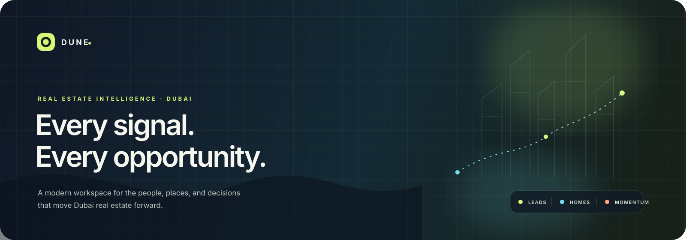
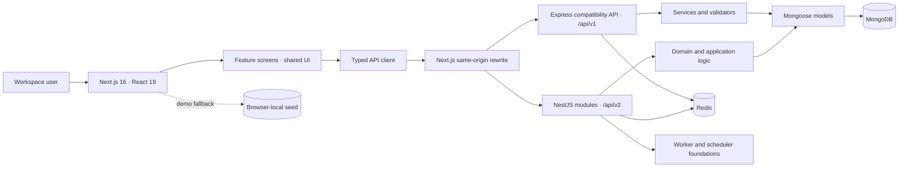

<div align="center">
  
  <br />
  <p>
    
    
    
    
  </p>
  <p><strong>A considered command center for Dubai real estate.</strong></p>
  <p>Lead intelligence · property discovery · team momentum · demo-safe workflows</p>
</div>

<br />

> **Dune** brings people, properties, and follow-up into one visually focused workspace. It pairs a modern Next.js application with a versioned API, operational data services, and a ready-to-record demo environment.

<p align="center">
  <a href="#-the-workspace">Workspace</a> ·
  <a href="#-architecture">Architecture</a> ·
  <a href="#-launch-the-demo">Demo</a> ·
  <a href="#-development">Development</a> ·
  <a href="#-project-map">Project map</a>
</p>

<details>
  <summary><strong>✦ At a glance</strong></summary>
  <br />

| Workspace | What it brings together |
|:--|:--|
| **Overview** | Pipeline pulse, high-intent signals, recent leads, featured supply, and campaign activity |
| **Leads** | Search, filters, lead scoring, quality and intent signals, assignment, activity, and follow-up |
| **Properties** | Dubai listings with image galleries, location, price, amenities, market context, and saved homes |
| **Growth** | Campaign planning, recipients, schedule, performance, and demo-safe action simulations |
| **People** | Agent and team visibility, roles, assignment, and performance context |
| **Operations** | Analytics, source and scraper configuration, webhooks, profile, and workspace settings |

</details>

## ◌ The workspace

Dune is designed around a simple working rhythm: **notice intent → find a fit → make a thoughtful move → learn from the outcome.**

<table>
  <tr>
    <td width="33%"><h3>01 · Read the signal</h3><p>Prioritize leads with score, intent, quality, timeline, source, and activity context. Keep the pipeline legible as it moves from first contact to closed deal.</p></td>
    <td width="33%"><h3>02 · See the place</h3><p>Explore Dubai inventory through image-led cards and listing details. Compare price, location, property type, size, and market signals in one view.</p></td>
    <td width="33%"><h3>03 · Move with care</h3><p>Coordinate ownership, follow-up, and campaigns across a team. Demo actions are clearly simulated wherever a real external integration is not configured.</p></td>
  </tr>
</table>

<details>
  <summary><strong>Demo behavior and integration boundaries</strong></summary>
  <br />

The isolated demo seeds sample data into its own local Mongo database and Redis index. Campaign actions, scraper runs, and webhook tests are simulated; they do not send messages, scrape live sites, or make outbound webhook requests. A browser-only fallback can keep the workspace usable when the demo API is unavailable; its changes remain in that browser. Listing photography is loaded from Unsplash, so displaying those photos requires an internet connection.

</details>

## ⌁ Architecture

The application currently runs as a **modular backend with a compatibility API**: native NestJS modules are exposed under `/api/v2`, while legacy Express routes remain under `/api/v1` during migration. The frontend talks to the API through a same-origin Next.js rewrite.



<details>
  <summary><strong>Runtime layers</strong></summary>
  <br />

| Layer | Responsibility |
|:--|:--|
| `frontend/` | Next.js App Router, React feature screens, shared UI, API client, local-demo fallback |
| `backend/src/api/` and feature modules | NestJS controllers, DTOs, modules, and native versioned endpoints |
| `backend/src/routes/`, `controllers/`, `services/` | Express compatibility surface and established `/api/v1` behavior |
| `backend/src/domain/` | Lead scoring, deduplication, status, assignment, analytics, and webhook rules |
| `backend/src/models/` | MongoDB persistence models and indexes |
| `backend/src/queues/`, `workers/`, `events/`, `outbox/` | Queue, scheduled-work, event, and delivery foundations |
| `backend/scripts/` | Isolated demo environment orchestration and sample data seeding |

</details>

> **Evolution note:** the migration is intentionally incremental. `/api/v2` and the `/api/v1` compatibility layer coexist today; not every screen or integration has moved to the newer backend surface. The architecture review and execution notes document the intended direction and current boundaries.

## ✷ Launch the demo

### Windows · one-click setup

1. Install [Node.js 20+](https://nodejs.org/) and have MongoDB and Redis available locally. If they are not running, the demo launcher can start isolated containers through Docker Desktop.
2. Run **`run-demo.bat`** from the project root.
3. Open [http://localhost:3010](http://localhost:3010). The landing page links into the workspace.

The launcher creates `backend/.env.demo` with generated local-only secrets, checks the demo database boundary, seeds sample data, and starts the API, worker, and frontend. The seed script is restricted to the local `dubai-realestate-demo` Mongo database. Re-running **`seed-demo.bat`** recreates that demo dataset; it clears and repopulates that isolated database.

| Destination | URL |
|:--|:--|
| Landing page | [http://localhost:3010/](http://localhost:3010/) |
| Workspace login | [http://localhost:3010/login](http://localhost:3010/login) |
| API health | [http://localhost:5010/api/v1/health](http://localhost:5010/api/v1/health) |
| API documentation | [http://localhost:5010/api/docs](http://localhost:5010/api/docs) |

### Seeded workspace access

Use the **Use demo access** button on the login screen, or use any account below. Seeded accounts share this demo-only password:

```text
Demo@123456
```

<table>
  <tr><th>Role</th><th>Email</th></tr>
  <tr><td>Administrator</td><td><code>admin@dubairealestate.com</code></td></tr>
  <tr><td>Manager</td><td><code>manager@dubairealestate.com</code></td></tr>
  <tr><td>Agent</td><td><code>ahmed@dubairealestate.com</code></td></tr>
  <tr><td>Agent</td><td><code>omar@dubairealestate.com</code></td></tr>
  <tr><td>Agent</td><td><code>fatima@dubairealestate.com</code></td></tr>
  <tr><td>Agent</td><td><code>khalid@dubairealestate.com</code></td></tr>
  <tr><td>Agent</td><td><code>noor@dubairealestate.com</code></td></tr>
  <tr><td>Agent</td><td><code>mohammed@dubairealestate.com</code></td></tr>
</table>

The prepared demo workspace includes **8 users · 60 leads · 35 properties · 6 campaigns · 4 scrapers · 3 webhook examples · activity history**.

### Recording route

For a clean take, start on the landing page, enter with the demo access button, then move through the overview, lead filters and lead detail, property gallery and listing details, campaign views, team, analytics, and settings. The [demo recording guide](./DEMO_RECORDING_GUIDE.md) includes a longer walkthrough.

<details>
  <summary><strong>Other launcher controls</strong></summary>
  <br />

| File | Use |
|:--|:--|
| `run-demo.bat` | Start the isolated demo, seed it, then open the landing page |
| `seed-demo.bat` | Restore the demo seed between recordings |
| `stop-demo.bat` | Stop only processes managed by the demo launcher |
| `run.bat` | Start the regular local application workflow |
| `stop.bat` | Stop the regular local application processes |

</details>

## ⌘ Development

### Requirements

- Node.js **20 or newer**
- npm
- MongoDB and Redis for the full API-backed workspace
- Docker Desktop if you want the demo launcher to provision isolated local services

### Install dependencies

```bash
cd backend
npm install

cd ../frontend
npm install
```

### Run services directly

Copy `backend/.env.example` to `backend/.env`, configure local MongoDB and Redis, then run the API and frontend in separate terminals:

```bash
cd backend
npm run dev
```

```bash
cd frontend
npm run dev
```

The regular frontend listens on port `3000`; its API rewrite defaults to `http://localhost:5000`. For the dedicated demo, use `run-demo.bat` so the API, worker, frontend, environment, and demo database remain isolated.

### Useful commands

| Package | Command | Purpose |
|:--|:--|:--|
| Backend | `npm run dev` | Start the API in watch mode |
| Backend | `npm run dev:worker` | Start the worker process |
| Backend | `npm run build` | Compile the backend |
| Backend | `npm run typecheck` | Check backend TypeScript |
| Backend | `npm test` | Run unit and integration suites |
| Backend | `npm run seed:demo` | Seed only the guarded demo database |
| Frontend | `npm run dev` | Start Next.js on port `3000` |
| Frontend | `npm run dev:demo` | Start Next.js on port `3010` |
| Frontend | `npm run build` | Create a production frontend build |
| Frontend | `npm run typecheck` | Check frontend TypeScript |

### Configuration and safety

- Keep real `.env` and `.env.local` files out of version control. Use the tracked example files as templates.
- The demo launcher generates local signing keys and points the API at its isolated Mongo and Redis databases.
- Demo seeding is destructive **only to the dedicated demo dataset**; do not point it at a non-demo database.
- Sample campaign, scraper, and webhook activity is simulated. Configure provider credentials and review integration safety before enabling real delivery.

## ◫ Project map

```text
.
├── backend/
│   ├── docs/openapi.yaml
│   ├── scripts/              # Demo launcher, seed, and migration utilities
│   ├── src/
│   │   ├── api/              # Native NestJS API modules
│   │   ├── domain/           # Domain policies and calculations
│   │   ├── models/           # Mongo persistence
│   │   ├── routes/           # Legacy /api/v1 routes
│   │   ├── services/         # Application services
│   │   └── workers/          # Scheduled and background-work foundations
│   └── tests/                # Unit and integration suites
├── frontend/
│   └── src/
│       ├── app/              # App Router and route layouts
│       ├── components/       # Shared design system and workspace UI
│       ├── features/         # Product feature screens and logic
│       ├── lib/              # API client, demo fallback, utilities
│       └── types/            # Frontend contracts
├── docs/assets/              # Repository artwork
├── ARCHITECTURE_REVIEW_AND_EVOLUTION_PLAN.md
├── DEMO_RECORDING_GUIDE.md
├── run-demo.bat
└── docker-compose.demo.yml
```

## ◇ Project notes

- [Architecture review and evolution plan](./ARCHITECTURE_REVIEW_AND_EVOLUTION_PLAN.md)
- [Evolution execution status](./EVOLUTION_EXECUTION_STATUS.md)
- [Demo recording guide](./DEMO_RECORDING_GUIDE.md)
- [OpenAPI source](./backend/docs/openapi.yaml)

<div align="center">
  <br />
  <sub>Built for thoughtful real estate work in Dubai · DUNE ◦</sub>
</div>
